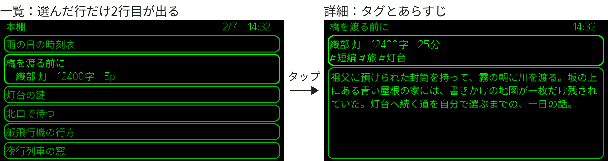

# even-g2-design-system

> **⚠ 内容は未調整です。**
> 技術書典21の合同誌（Smart Glasses Creative Lab）に書いた章「Even G2アプリのUI設計」の参考資料として、整備の途中で公開しています。文章・コード・画像は、推敲や整合の確認が済んでいません。内容は予告なく変更・削除することがあります。このリポジトリでは、実機やシミュレーターでの表示を確かめていません（確かめた範囲は [docs/verification.md](docs/verification.md) を見てください）。

Even G2 のグラス画面（576×288、緑単色）に出す UI を、決まった寸法・色・時間・操作の規則で組むための部品集です。作者が自作アプリで使っている共通部品から、画面の組み立てに関わる部分を切り出しました。

公式のガイドラインではありません。また、ここにあるコードは実機での動作を確かめた完成アプリではなく、作者のアプリで共通に使っている部品とその標準値を参考として公開するものです。検証した範囲は [docs/verification.md](docs/verification.md) にまとめています。



部品集を使うアプリ側の画面を、架空データで公式シミュレーターに表示した例です。実機の写真ではなく、`npm run example` の出力を描画したものでもありません。一覧の 2 行目の字下げは撮影用に加えたものです。ほかの画像と注記は [docs/screenshots.md](docs/screenshots.md) にあります。

## できること

- 標準値（`GLASS`）に沿って、上段・本文枠・一覧・確認の text container を組み立てる
- 全画面で text container を ID 1〜8 の 8 枚にそろえる
- タッチ入力の正規化（スワイプの間引き、誤タップの破棄、上下反転）
- 長押しの連続送り、一時通知、初回ヒント、再試行のタイマー
- 文字の表示幅（px）に基づく切り詰め

部品は SDK（`@evenrealities/even_hub_sdk`）の `TextContainerProperty` などを作って返すところまでを担います。`rebuildPageContainer` / `textContainerUpgrade` を呼んで実際に描画するのはアプリ側です。

## 必要なもの

- Node.js 24 以降（`npm run example` は Node の型除去で `.ts` を直接実行します）
- npm

## 使い方

```sh
npm install
npm test          # vitest
npm run typecheck # tsc --noEmit
npm run example   # 架空データで一覧と本文のコンテナ定義 JSON を出力
```

`npm run example` は `examples/output/list.json` と `examples/output/body.json` を書き出し、各コンテナの ID・名前・位置を標準出力に表示します。出力先は `.gitignore` に入れてあります。

アプリから使うときはサブパスで読み込みます。

```ts
import { topBar, topLayout, layoutList, padToFixedSet } from 'even-g2-design-system/ui'

const bar = topBar({ layout: topLayout(items.length), left: '作品一覧', pos: { index: 2, total: items.length }, offline: false, clock: '14:32' })
const list = layoutList({ items, cursor: 1, pageStart: 0, renderSelected: (it) => [it.title, it.meta], renderRow: (it) => it.title })
const containers = padToFixedSet([...bar.containers, ...list.faces])
```

パッケージは `private: true` で、npm には公開していません。TypeScript のソースをそのまま公開しているため、利用側はバンドラ（`moduleResolution: "bundler"`）で読み込む前提です。

## 構成

| パス | 内容 |
|---|---|
| `src/ui` | 画面の部品と標準値（`GLASS`、`WORDS`）。この参考実装の中心 |
| `src/text` | 表示幅の計測と切り詰め（`@evenrealities/pretext` を使用） |
| `src/events` | SDK のイベントを操作の種類に分類する。スワイプの間引き |
| `src/storage` | SDK の保存領域の薄いラッパー。`ui` は型 `Kv` だけを使う |
| `src/i18n` | 言語の型 `Lang` と文言テーブルの引き方 |
| `examples/run.ts` | 一覧と本文のコンテナ定義を出力する例 |
| `docs/` | 設計の説明 |
| `assets/reference/` | 参考画像 4 点 |

`text` / `events` / `storage` / `i18n` は `ui` の依存先として一緒に切り出したものです。

## ドキュメント

| 文書 | 内容 |
|---|---|
| [docs/principles.md](docs/principles.md) | 設計原則 |
| [docs/layout.md](docs/layout.md) | 画面の割り付けと標準値 |
| [docs/interaction.md](docs/interaction.md) | 操作と状態の見せ方 |
| [docs/components.md](docs/components.md) | 部品の API |
| [docs/verification.md](docs/verification.md) | 検証した範囲と未検証の点 |
| [docs/screenshots.md](docs/screenshots.md) | 参考画像の用途・操作・出自と注記 |
| [docs/roadmap.md](docs/roadmap.md) | 今後の整備 |

## ライセンス

未定です。決まるまでは、コードと画像の再利用・再配布の許諾はしていません。
