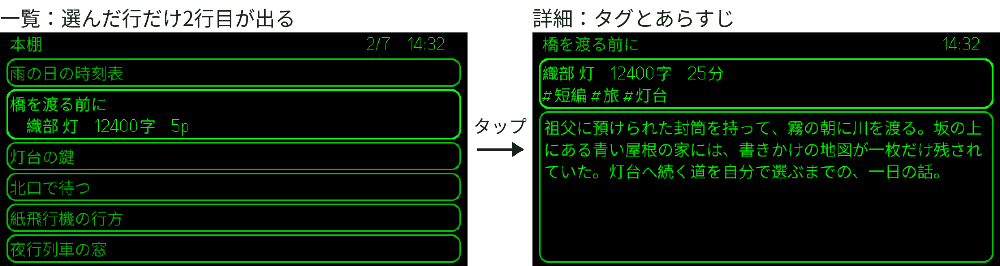
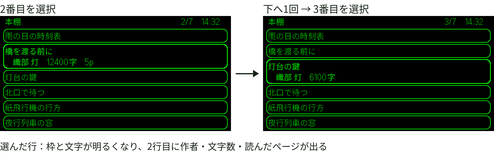
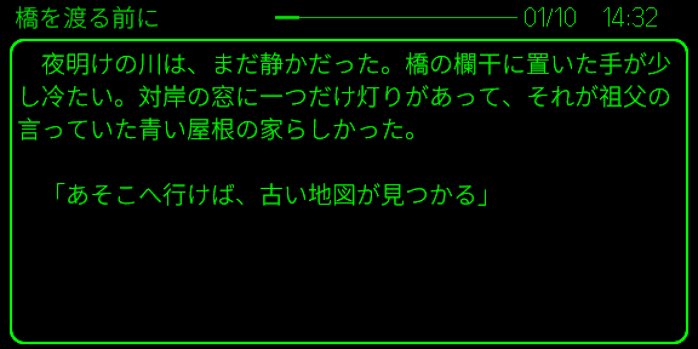
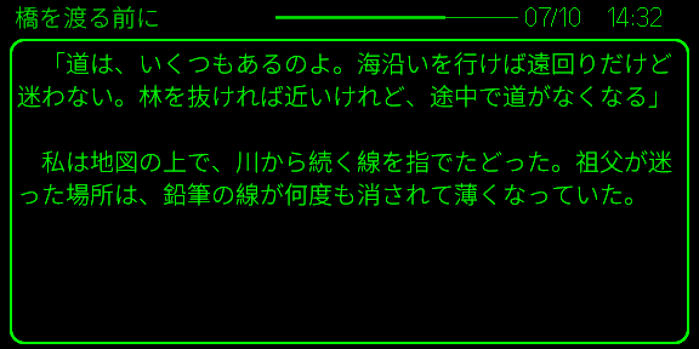

# 参考画像

`assets/reference/` の 4 点は、技術書典21の章「Even G2アプリのUI設計」に掲載した図版の現行版です。この部品集を使うアプリ側の画面の例として置いています。

## 共通の注記

- 実機の写真ではありません。公式シミュレーター 0.9.5 の出力です。光学的な見え方や明るさを測ったものでもありません
- `examples/run.ts` の出力を描画した画像ではありません。共通部品を使うアプリ側の描画処理で作った画面です。そのため、例の JSON とは題名・件数・配置が一致しません
- 作品名・作者名・本文・数値は撮影用の架空データです。時刻 14:32 は固定値です
- 画面の論理寸法は 576×288 です。黒地に重ねて 2 倍に拡大しています
- 画像は掲載したものをそのまま入れており、描き直しや差し替えはしていません
- ライセンスはコードと同じく未定です

## reader-flow.png



| 項目 | 内容 |
|---|---|
| 用途 | 一覧から詳細へ進む流れ。選んだ項目だけを 2 行に広げる表示 |
| 操作 | 一覧で項目を選んでタップすると詳細（タグとあらすじ）が開く。詳細からさらにタップすると本文へ進む（本文は reader-first.png と reader-middle.png） |
| 出自 | アプリの描画処理に架空データを渡し、公式シミュレーター 0.9.5 で表示 |
| 注記 | 画面の外にある見出しと矢印は説明用に加えたものです。一覧は最大 6 件を表示し、選んだ項目は 2 行になります。一覧の 2 行目の字下げは撮影用のデータで加えたもので、現行のアプリは字下げしません |

## selection.png



| 項目 | 内容 |
|---|---|
| 用途 | 選択の示し方。枠と文字の強調、選んだ項目の高さの変化 |
| 操作 | 2 番目の項目を選んだ状態から下へ 1 回送り、3 番目を選んだ状態 |
| 出自 | reader-flow.png と同じ一覧を、同じ方法で表示 |
| 注記 | 画面の外の見出し・矢印・説明文は説明用です。上段右の `2/7` `3/7` は項目の位置と総件数で、7 件のうち 6 件を表示しています。`5p` は保存された読書位置で、全ページ数ではありません。未読の項目には読書位置を出しません。2 行目の字下げは撮影用です |

## reader-first.png



| 項目 | 内容 |
|---|---|
| 用途 | 本文の表示。上段の題名・進捗バー・ページ番号・時計と、8 行の本文枠 |
| 操作 | 詳細からタップして本文に入った最初のページ（`01/10`） |
| 出自 | アプリのページ分けと描画処理に架空の短編を渡し、公式シミュレーター 0.9.5 で表示 |
| 注記 | 画面の外の説明はありません |

## reader-middle.png



| 項目 | 内容 |
|---|---|
| 用途 | ページを進めたときの進捗バーの変化 |
| 操作 | 同じ短編を下へ送って進めた途中のページ（`07/10`） |
| 出自 | reader-first.png と同じ方法で表示 |
| 注記 | 本文枠の大きさは変えず、ページごとに切り替えています |

## SHA-256

| ファイル | SHA-256 |
|---|---|
| `reader-flow.png` | `73317c095b5382c9fad2524b722aa8a565ea81fd5780d0cf9584da994420f42a` |
| `selection.png` | `a432d613b6aadb6e1cb710db4752348abebbc5550bff9c76052c04d79296db05` |
| `reader-first.png` | `00a46f53b4585e0f621a406ae5e27a11bc1f308955cf3f85cc2354e998441c43` |
| `reader-middle.png` | `78feab6aada4c1811f448b2117a7603e3bb7eae8afba177fe99fcac23d1783fc` |

リポジトリの直下で次のコマンドを実行すると照合できます。

```sh
sha256sum assets/reference/*.png
```
